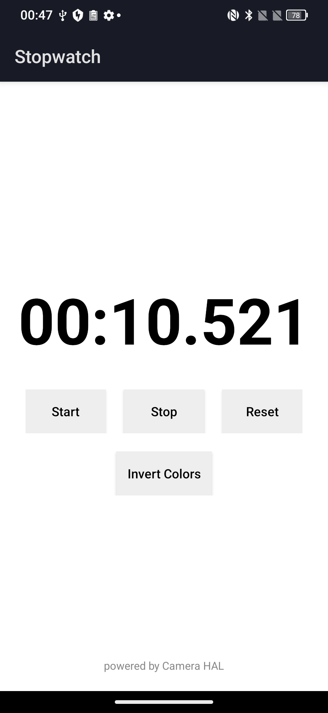
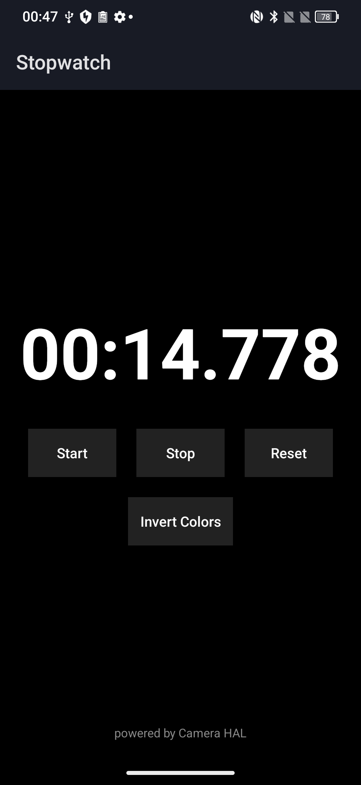

# 秒表应用项目说明

## 应用界面示例
<p align="center">
  
   
</p>


## 环境配置要求

1. Gradle版本配置：
   - 请根据本地Gradle版本修改`build.gradle`文件中的`classpath 'com.android.tools.build:gradle:8.5.1'`
   - 若本地无此版本，系统将自动下载（此过程可能较耗时）
   
2. SDK路径配置：
   - 请修改`local.properties`文件中的SDK路径为本地实际路径

## 项目构建说明

1. 初始化构建环境：
   - 使用`gradle.bat wrapper`命令生成`.gradle`目录和`gradlew`可执行文件

2. 编译项目：
   - 成功初始化后，可使用以下命令进行编译：
     - `./gradlew assembleRelease`（生成发布版本）
     - `./gradlew assembleDebug`（生成调试版本）
   - 编译生成的APK文件位于`build/outputs/apk`目录

3. 清理构建：
   - 如需重新构建，可执行以下操作之一：
     - 删除`build`目录
     - 执行`./gradlew clean`命令

## AOSP 源码集成编译说明

### 1. 集成到 AOSP 源码树
将本项目的 `stopwatch` 文件夹放置到 AOSP 源码的以下路径：
```
AOSP_ROOT/vendor/stopwatch/  # 推荐位置（需自行创建vendor目录）
或
AOSP_ROOT/packages/apps/stopwatch/
```

### 2. 修改 AOSP 编译配置
在对应位置的 `Android.mk` 或 `Android.bp` 同级目录添加：

#### 方案A：使用现有 Android.mk
直接使用项目自带的 `Android.mk` 文件，无需修改

#### 方案B：创建 Android.bp (未验证)
```bp
android_app {
    name: "Stopwatch",
    srcs: ["app/src/main/java/**/*.java"],
    resource_dirs: ["app/src/main/res"],
    manifest: "app/src/main/AndroidManifest.xml",
    sdk_version: "current",
    optimize: {
        enabled: false,
    },
}
```

### 3. 添加编译入口（单编不需要）
在 AOSP 的 `build/make/target/product` 目录下找到对应的产品配置文件（如 `aosp_arm64.mk`），添加：
```makefile
PRODUCT_PACKAGES += Stopwatch
```

### 4. 编译命令
```bash
# 全编
make -j8

# 单独编译模块
mma -j8
# 或
make Stopwatch
```

### 注意事项
1. 确保 AOSP 环境已初始化（执行过 `source build/envsetup.sh` 和 `lunch`）
2. 如果遇到资源冲突，检查 `AndroidManifest.xml` 中的 `package` 命名是否唯一
3. 自适应图标需要 API 26+ 支持，请确认目标产品的 `PRODUCT_SDK_VERSION`